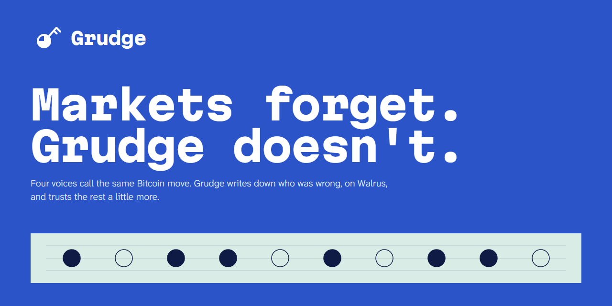

# Grudge



Markets forget. Grudge doesn't.

Every five and fifteen minutes, four sources call whether Bitcoin ends the window higher: DeepBook (an onchain market on Sui), Polymarket, Kalshi, and the Crowd, which is whatever visitors pick. Grudge freezes their calls at a lock time, waits for the result, and grades each call like a weather forecast. A source that keeps missing counts for less next time. The record lives on Walrus.

Live: https://grudge-l19c.onrender.com ([Board](https://grudge-l19c.onrender.com), [Receipts](https://grudge-l19c.onrender.com/receipts), [Agents](https://grudge-l19c.onrender.com/agents))

Built for the Walrus x Tatum "Total Recall" hackathon. Tracks: Markets & Sports Prediction, Best Walrus Memory, Best Agent Payments.

## What it does

- **Board.** The line Grudge would give now, each source's call, its trust and its Brier score, the last 20 windows, and the lesson Grudge recalled from Walrus when two sources disagree by 7 points or more. Visitors can log their own call before the lock.
- **Receipts.** Every memory as a Walrus blob with a Walruscan link, the payments with Suiscan links, Tatum call counts, and the memory check: rebuild the weights from Walrus alone and compare them with the live ones.
- **Agents.** A paid API. An agent asks, gets a `402` with the price, pays in USDC on Sui, asks again, and gets the line.

## How it uses Walrus

Walrus Memory holds the ledger, in three namespaces on mainnet: one record per resolved window, a scoreboard snapshot every few records, and a one-sentence lesson every 25 windows. Writes go through an outbox in batches of 20 at most, into hourly namespaces, because recall returns the most similar memories and not the newest.

With an empty database the server restores the latest snapshot, replays the records after it, and brings the lessons back. `POST /api/verify-memory` does the same rebuild without touching anything and reports the largest gap against the live weights. At the last check the gap was 0.

## How it uses Tatum

Every market and chain read goes through Tatum gRPC on Sui mainnet, behind one throttle of 3 requests a second (the free plan). Bitcoin's price comes from the Tatum Data API. Payments are simulated and executed through Tatum gRPC.

## How agents pay

`GET /api/consensus?category=btc-5m|btc-15m` speaks x402 v2, scheme `exact`, USDC on `sui:mainnet`. The price runs from 0.010 to 0.050 USDC and rises with Grudge's confidence. The server checks the signed quote, the exact terms, the transaction signature, a simulation, and that the treasury receives the full amount, then claims the digest and executes. A used digest is refused. The server holds no key, and the payer needs no SUI. Details in [docs/API.md](docs/API.md).

One real payment has settled: 0.038 USDC, [digest `4f3bXYdmR1XYJTvVrm17HEat4aDSePvShTcqAZmeSnTY`](https://suiscan.xyz/mainnet/tx/4f3bXYdmR1XYJTvVrm17HEat4aDSePvShTcqAZmeSnTY). A replay of it was refused. Nobody outside this project has bought a line.

`pnpm agent` is the client that did it. It buys only when the sources disagree and refuses to pay over 0.05 USDC a call.

## Is it learning?

Slightly, and not by a margin the data supports. Mean Brier score over the last 100 resolved windows (lower is better), read from `/api/receipts` on 9 November 2026:

| | Grudge | Equal weights | Best source alone |
| --- | --- | --- | --- |
| btc-5m | 0.1875 | 0.1894 | DeepBook 0.1897 |
| btc-15m | 0.1711 | 0.1725 | Kalshi 0.1682 |

Grudge's gain over equal weights is +0.0018 ± 0.0111 (5 minutes) and +0.0014 ± 0.0034 (15 minutes), 95% intervals. Both include zero. In the 15-minute market Kalshi alone scored better than Grudge. These numbers move with every window; the live ones are on [Receipts](https://grudge-l19c.onrender.com/receipts).

What memory changes: the weights each source gets. It does not change what Grudge asks.

## Run it

```
pnpm install
cp .env.example .env     # fill it in; each variable says where its value comes from
pnpm dev
```

`pnpm dev` starts the worker that resolves windows and writes memories. A second worker double-writes, so for UI work against production data run `GRUDGE_WORKER=off pnpm dev --port 3100`.

| Command | Does |
| --- | --- |
| `pnpm test` | Vitest: the engine, the memory codec, the x402 path and each page's model |
| `pnpm e2e` | One Playwright test: board, a pick, the memory check, the price and the 404, with every API call answered from a recorded fixture (first run: `pnpm exec playwright install chromium`) |
| `pnpm lint`, `pnpm typecheck` | Biome, and `tsc` in strict mode |
| `pnpm probe` | A live check of every external source Grudge reads |
| `pnpm agent` | Buys one line over x402 (needs `AGENT_PRIVATE_KEY` in `.env`) |

Stack: Next.js, TypeScript (strict, Zod at every boundary), Postgres through Drizzle, Walrus Memory, Tatum, USDC on Sui.

## Where things are

- `src/server/engine`: the scoring and weighting. Pure, time is passed in.
- `src/server/memory`: the codec, the outbox and the rebuild from Walrus.
- `src/server/x402`: the payment path.
- `src/app`: the three pages and the API routes.
- [docs/ARCHITECTURE.md](docs/ARCHITECTURE.md) has the data flow and the runbook; [docs/ASSUMPTIONS.md](docs/ASSUMPTIONS.md) lists what the numbers can and cannot support.

## Licence

MIT. See [LICENSE](LICENSE).
