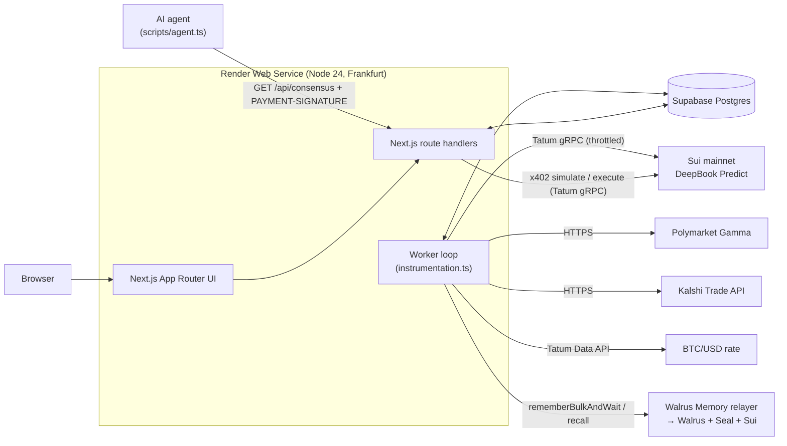

# Grudge: Product Requirements & Build Guide

> **Markets forget. Grudge doesn't.**
> Version 1.0 · 2026-11-07 · Owner: solo builder · Status: **Approved for build**
> This document is the single source of truth for the project. When code and this doc disagree, fix one of them on purpose and never let the two drift apart.
> Brand and voice: [brand-guidelines.md](brand-guidelines.md).

---

## 0. TL;DR

Grudge watches four voices call the same Bitcoin move:

- **DeepBook Predict** (onchain on Sui, read through **Tatum's Sui gRPC gateway**)
- **Polymarket**
- **Kalshi**
- **the Crowd** (visitors' own picks)

Every 5 and 15 minutes, a window resolves and Grudge then:

1. scores each voice (Brier score);
2. updates trust weights with **Hedge** (exponential weights);
3. publishes a trust-weighted **Grudge line**;
4. writes the record, the scoreboard and periodic "lessons" to **Walrus Memory on mainnet**.

Wipe the server and the grudges survive, because the weights are rebuilt from Walrus. AI agents pay **0.01–0.05 USDC per call over x402**, settled gaslessly on Sui mainnet through Tatum, to borrow Grudge's memory. The price rises as Grudge learns.

**Target prizes:** Track 1 (Markets & Sports Prediction), Best Walrus Memory, Best Use of Agent Payments. The AI Builder award is out of scope: it conflicts with our authenticity standard (§15).

**Deadline:** submissions close **2026-11-10 17:00 UTC**. Our own cutoff is **14:00 UTC**.

---

## 1. Why this wins (strategy)

| Judging criterion          | Weight | How Grudge scores                                                                                                                                                                                                                                            |
| -------------------------- | ------ | ------------------------------------------------------------------------------------------------------------------------------------------------------------------------------------------------------------------------------------------------------------ |
| Walrus + Tatum integration | 30%    | **Walrus Memory is the learning state, not a log.** Weights rebuild from it, the UI recalls lessons from it, and agents pay for it. Tatum is used four ways: gRPC (DeepBook reads + x402 settlement), GraphQL (payment ledger), and the Data API (BTC spot). |
| Technical quality          | 30%    | Strict TypeScript, pure tested scoring core, typed boundaries (zod), an outbox for memory writes, a throttled transport for Tatum, and a spec-compliant x402 v2 `exact` scheme on Sui. The server holds **no private key**.                                  |
| Creativity                 | 20%    | It is the **only** entry comparing an _onchain Sui_ odds source against offchain venues; ~150 competitor repos were checked. The "holds grudges" concept is memorable, and a price that rises as Grudge learns is new.                                       |
| Presentation               | 20%    | A distinct brand, a live gauge, a receipts page with every Walrus blob and Sui digest, a 2–3 min video, and a blog with real learning numbers.                                                                                                               |
| Bonus                      | —      | X + LinkedIn posts tagging @Tatum_io and @WalrusFoundation.                                                                                                                                                                                                  |

**Competitive notes:** see the research summary in the plan.

- Clichés we avoid: pick journals, bill splitting, wallet guards.
- "Memory ON vs OFF" charts are now table stakes, so we have one, but our edge is elsewhere:
  1. the onchain Sui source;
  2. fast markets, so learning is visible live (≈400 resolutions/day);
  3. memory that is priced.

---

## 2. Users & jobs

| Persona                               | Job to be done                                                          | What they see                                                                          |
| ------------------------------------- | ----------------------------------------------------------------------- | -------------------------------------------------------------------------------------- |
| **Judge** (primary, ~5 min attention) | "Does this meaningfully use Walrus + Tatum, and does it visibly learn?" | Landing gauge → disagreement card with a recalled lesson → receipts page → 2-min video |
| **Bettor / forecaster**               | "Before I bet on BTC's next 15 minutes, who should I believe?"          | Grudge line + which venue Grudge leans on + their own record vs the markets            |
| **AI agent**                          | "Give me a calibrated probability I can trust, and I'll pay per call."  | `GET /api/consensus` → 402 → pays USDC → JSON with line, weights, lesson, receipts     |

---

## 3. Scope

### P0: must ship (each has acceptance criteria in §11)

1. **Ingestion**
   - Discover questions for `btc-5m` and `btc-15m` windows.
   - Read live probabilities from DeepBook (Tatum gRPC), Polymarket (Gamma) and Kalshi (Trade API v2).
2. **Lock & resolve**
   - Freeze every voice's call at the same instant.
   - Resolve using venue results, with a majority rule and split detection.
3. **Learning**
   - Per-category Hedge weights, Grudge line, confidence, price.
4. **Walrus Memory**
   - Outbox → `rememberBulkAndWait` on mainnet.
   - Three namespaces: records, scoreboard, lessons.
   - Cold boot from Walrus.
5. **Crowd picks:** visitors pick ▲/▼ with confidence before lock. Each visitor gets a personal Brier score vs the markets.
6. **UI:** board (gauge, source cards with tally marks, disagreement card, ledger), on-brand, mobile-friendly.
7. **x402 paid API:** spec-compliant v2 `exact` on `sui:mainnet`, USDC, gasless, verified and settled via Tatum gRPC, with a replay guard.
8. **Agent demo:** `scripts/agent.ts` pays, receives the consensus, and prints the Suiscan link.
9. **Receipts page:**
   - memory count + Walruscan links;
   - payments + Suiscan links;
   - Tatum call counters;
   - the learning curve (Grudge vs equal-weight vs best single source).
10. **Amnesia demo:** admin endpoint wipes working state, rebuilds from Walrus, and shows "N grudges restored".
11. **Deliverables:** live deploy, public repo, README, blog post, 2–3 min video, social posts, submission form.
12. **Documentation** (map and update rules in `CLAUDE.md`):
    - `README.md` (judges)
    - `docs/ARCHITECTURE.md` (as-built modules, data flow, memory format, x402 sequence, runbook)
    - `docs/API.md` (public endpoints + x402 walkthrough with curl)
    - `docs/DECISIONS.md` (decision log)
    - `docs/HANDOFF.md` (live build state, refreshed by the `handoff` skill at every gate)

### P1: only if P0 is done by the Day 2 18:00 UTC gate

- **Ask Grudge:** a natural-language question answered from recalled memories by Claude (`claude-sonnet-5-5`), in Grudge's voice.
- **Live revenue ledger** read from Tatum GraphQL (incoming USDC to the treasury), verified independently of our DB.
- Hourly ladder markets (Kalshi `KXBTCD`) with strike interpolation.

### Out of scope (explicitly)

- Wallet login and per-user Walrus namespaces.
- Trading on any venue.
- Sports and The Odds API.
- Light theme.
- Mobile app.
- LLM-written lessons in P0 (lessons come from templates, which is deterministic and honest).

---

## 4. Verified facts (checked live on 2026-11-07 — do not re-research)

### 4.1 DeepBook Predict (mainnet, live)

- **SDK:** `@mysten/deepbook-v3@2.11.1`, subpath `/predict`. Usage: `new SuiGrpcClient(...).$extend(predict({ network: 'mainnet' }))`.
- **Reads** run over `simulateTransaction`; no indexer is needed.
- **Markets:** `read.markets()` returns `{ id, expiryMs, tickSize, admissionTickSize, mintPaused, referencePrice }`.
  - Mainnet cadences: **1m and 5m only**.
  - 5m expiries land exactly on UTC 300-second marks (verified: `13:00:00Z`, `13:05:00Z`).
  - `referencePrice` is `null` until the window opens.
  - The reference price of window T equals the settlement price of window T−5m (verified: chained 75808.87).
- **Pricing:** `read.pricer({ underlying: 'BTC', expiryMs })` returns `.up(K)` = P(settle > K), plus `.forward` and `.asOf`.
  - **Check `asOf` for staleness**: a stale pricer still returns numbers.
  - Verified: `up(ref) = 0.4935` at T−5m.
- **Settlement:** `read.settlement({ underlying:'BTC', expiryMs, strike:'reference', side:'up' })` returns `{ settled, settlementPrice }` (verified).
- **Oracle:** Pyth, with Block Scholes as fallback. Up wins if settle > strike (strict).

### 4.2 Polymarket (reads need no auth; DNS-blocked on the dev network, see §10.4)

- **Slugs:** `btc-updown-5m-{S}` and `btc-updown-15m-{S}`, where `S` = window start in unix seconds (`floor(now/dur)*dur`).
- **Market lookup:** `GET https://gamma-api.polymarket.com/markets?slug={slug}`.
  - Returns **open markets only by default**. Add `&closed=true` to get resolved ones.
  - Fields: `outcomes` (JSON string `["Up","Down"]`), `outcomePrices` (JSON string), `bestBid`, `bestAsk`, `lastTradePrice`, `closed`, `umaResolutionStatus`, `endDate`, `eventStartTime`.
- **Live p(Up):** `(bestBid + bestAsk) / 2`. If either is missing, fall back to `outcomePrices[0]`.
- **Resolution:** `closed=true`, `umaResolutionStatus="resolved"`, `outcomePrices=["1","0"]` means Up. Observed at about **end + 80 s**.
- **Resolution source:** Chainlink BTC/USD **60s TWAP** at the end, compared with the start price (≥ means Up).

### 4.3 Kalshi (reads need no auth)

- **Base URL:** `https://api.elections.kalshi.com/trade-api/v2`.
- **Series:** `KXBTC15M`. Ticker format: `KXBTC15M-26NOV070800-00` (the hhmm is the close time in ET).
- **Listing:** `GET /markets?series_ticker=KXBTC15M&status=open`, then match on `close_time` = T (ISO UTC).
- **Fields:**
  - `floor_strike` (number) and `strike_type: "greater_or_equal"`
  - `yes_bid_dollars` / `yes_ask_dollars` (strings)
  - `last_price_dollars`
  - `status` (`active` → `finalized`), `result` (`"yes"`/`"no"`/`""`), `expiration_value`
- **Live p(Up):** `(yes_bid + yes_ask) / 2`.
- **Resolution:** `status=finalized` and `result`.
- **Resolution source:** CF Benchmarks BRTI, 60s simple average before T, compared with the average before S.
- **Observed:** Kalshi 93% vs Polymarket 80% on the same 15m window. Real disagreements happen.

### 4.4 Tatum

- **Sui gRPC:** `sui-mainnet-grpc.gateway.tatum.io:443`, with `x-api-key` sent as **gRPC metadata**.
  - Use native `GrpcTransport` (`@protobuf-ts/grpc-transport`) with `ChannelCredentials.createSsl()` from `@grpc/grpc-js`. **gRPC-web fails.**
  - `SuiGrpcClient` accepts `{ network, transport: RpcTransport }`.
- **Sui GraphQL:** `POST https://sui-mainnet.gateway.tatum.io/graphql` with header `x-api-key`. One operation per request.
- **Sui JSON-RPC is gone** (removed Oct 2026). Don't use `suix_*`.
- **Data API:**
  - `GET https://api.tatum.io/v4/data/rate/symbol?symbol=BTC&basePair=USD` costs **20 credits**.
  - Tatum's Data APIs (portfolio/history) **do not support Sui**.
- **Free plan:** **3 req/s**, **100k credits**. Most RPC calls cost 2 credits; Day 0 measures the real cost of gRPC calls.
- On a plan limit Tatum returns HTTP 402 ("plan limit"). Treat it as a source outage, not a crash.
- **Verified gRPC methods** (`https://sui-mainnet-grpc.gateway.tatum.io/_methods`), the full set we use:
  - `TransactionExecutionService/SimulateTransaction` and `/ExecuteTransaction`
  - `SignatureVerificationService/VerifySignature`
  - `LedgerService/GetObject`, `BatchGetObjects`, `GetTransaction`, `ListTransactions`, `GetEpoch`, `GetServiceInfo`
  - `StateService/GetBalance`, `ListBalances`, `ListOwnedObjects`, `GetCoinInfo`, `ListDynamicFields`
  - `MovePackageService/*`
  - `SubscriptionService/SubscribeCheckpoints`
- **Still unverified (needs a key):** whether `GrpcTransport`'s `meta` option attaches `x-api-key` to every call, and what each call costs in credits. `scripts/probe.ts` checks both.

### 4.5 Walrus Memory

- **SDK:** `@mysten-incubation/memwal@0.1.13`, server-only (the relayer sends no CORS headers).
  - Peer deps: `@mysten/sui`, `@mysten/seal`. Optional: `@mysten/walrus`, `ai`, `zod`.
- **Relayer:** `https://relayer.memory.walrus.xyz` (healthy, API 1.0.0). It sponsors gas and WAL.
  - Its Sui endpoint is fixed by the relayer's `/config` and can't be pointed at Tatum.
- **Client:** `MemWal.create({ key, accountId, serverUrl, namespace })`.
- **Writes:** `rememberBulkAndWait(items ≤ 20)` returns `{ results: [{ id, blob_id, status, namespace }], succeeded, failed }`.
  - Writes take 20–90 s. Records count only when there is a `blob_id` and `status === 'done'`.
- **Reads:**
  - `recall({ query, namespace, topK, maxDistance, sort: 'relevance'|'recent' })` returns `{ results: [{ blob_id, text, distance, created_at }] }`.
  - `listMemories({ namespace, cursor })` returns metadata and blob IDs.
  - `restore(ns, limit ≤ 100)` rebuilds the relayer's index. Use it only if recall unexpectedly returns nothing.
- **Rate limits** (weighted per delegate key): 30/min and 500/h. `remember` = 5, bulk = 10, recall = 1.
- **Limits:** text ≤ 64 KiB; namespace ≤ 255 bytes; no metadata fields, so structure lives in the text.
- **Expiry:** blobs expire after about 3 epochs (~6 weeks), which still covers judging.
- **`MEMWAL_AGENT_ID`** = the delegate public key as hex (dashboard → Delegate keys).
- **Explorers:** `https://walruscan.com/mainnet/blob/{blobId}` and `https://suiscan.xyz/mainnet/tx/{digest}`.

### 4.6 x402 v2 on Sui (spec: x402-foundation/x402 `specs/schemes/exact/scheme_exact_sui.md`, `specs/transports-v2/http.md`)

- **Headers:**
  - `PAYMENT-REQUIRED` (server → client, base64 JSON `PaymentRequired`)
  - `PAYMENT-SIGNATURE` (client → server, base64 `PaymentPayload`)
  - `PAYMENT-RESPONSE` (server → client, base64 `SettlementResponse`)
- **PaymentRequirements:** `{ scheme:'exact', network:'sui:mainnet', amount (atomic string), asset (coin type), payTo, maxTimeoutSeconds, extra }`.
- **Payload:** `{ x402Version: 2, resource, accepted, payload: { signature, transaction (base64) } }`.
- **Verify** (spec order):
  1. network matches;
  2. the signature is valid over the tx;
  3. simulate succeeds and the tx is not already executed;
  4. `payTo` receives the right `amount` of `asset`.
  - Then **settle** by executing.
- **Gasless USDC** (mainnet):
  - `0x2::balance::send_funds<USDC>(tx.balance({ type: USDC, balance }), recipient)`.
  - `tx.build({ client: grpcClient })` sets gas price and budget to 0 automatically.
  - Minimum is **10_000 atomic (0.01 USDC)**.
  - The payer needs **no SUI**, and the executor pays nothing.
  - USDC = `0xdba34672e30cb065b1f93e3ab55318768fd6fef66c15942c9f7cb846e2f900e7::usdc::USDC` (6 decimals).

---

## 5. Product specification

### 5.1 Questions

A **question** asks: "Will BTC finish window `[S, T)` at or above where it started?" Id: `{category}:{T_unix_s}`, e.g. `btc-15m:1794057300`.

| Category  | Window                     | Lock at                   | Voices                              | DeepBook strike K                                                       |
| --------- | -------------------------- | ------------------------- | ----------------------------------- | ----------------------------------------------------------------------- |
| `btc-5m`  | 300 s on UTC 5-min marks   | **S + 120 s** (T − 180 s) | deepbook, polymarket, crowd         | the market's `referencePrice` (= Pyth at S)                             |
| `btc-15m` | 900 s on UTC quarter-hours | **S + 420 s** (T − 480 s) | deepbook, polymarket, kalshi, crowd | DeepBook settlement at S (= Pyth at S); fallback: Kalshi `floor_strike` |

- For `btc-15m`, DeepBook is priced with `pricer({ expiryMs: T }).up(K)` on the **5m market that expires at T**. That is the same question asked of a different venue.
  - That market is listed only about 6.5–10 min before T (verified 2026-11-07), which is why the 15m lock is T − 480 s and not earlier.
  - `pricer()` works while the market's `referencePrice` is still null (verified).
- **Lock rule:** every voice is captured in one pass at the lock instant. A voice that fails or is stale (DeepBook `asOf` > 30 s old; venue spread > 20 pts) is **absent** for that question, never guessed.
- **Crowd:** the mean of visitor picks submitted before lock. It is absent if there are 0 picks.
- **Picks:** each pick is a direction (▲/▼) plus a confidence of 55/65/80/95%, giving p = conf or 1 − conf.

### 5.2 Resolution

- Each venue gives its own result:
  - DeepBook: `settlement(T) > K`
  - Polymarket: `outcomePrices`
  - Kalshi: `result`
- Retry every tick from T + 60 s until **T + 20 min**, then resolve with whatever is available.
- **Canonical outcome** = majority of the venue results.
  - Unanimous: `resolved`.
  - 2–1: `resolved` with `split=true`.
  - 1–1 (two venues disagree, no third): `void` with `split=true`. Not scored, but recorded as a lesson-worthy event.
  - No venue result: `void`.
- **Why:** venues settle on different feeds (Pyth, Chainlink TWAP, BRTI average), and we say so openly. Splits are a feature: _"Feeds disagreed about reality. Grudge noted it."_

### 5.3 Learning (pure functions, fully unit-tested)

For each `(category, source)` we keep a discounted loss `L` and an effective count `N`. For every scored question, with outcome `o ∈ {0,1}` and call `p`:

```
b  = (p − o)²            // Brier
L ← λ·L + b ;  N ← λ·N + 1      // λ = 0.98 (≈50-question memory)
```

- **Weights** over the voices present for a question: `w_s = softmax(−η · L_s)` with `η = 0.5`.
  - `L` is a discounted *sum*, so it settles near 50× the mean Brier score. The textbook Hedge rate `sqrt(8 ln K / T)` with K = 4, T = 50 is ≈ 0.47. The earlier planned `η = 2` would turn a 0.03 Brier gap into a 20× weight ratio; `η = 0.5` gives 2.1× (decision log, 2026-11-07).
  - A new voice (`N < 5`) gets `L = mean(L of the established voices)`, so it is neutral until proven.
- **Grudge line:** `logit(p*) = Σ w_s · logit(clamp(p_s, 0.02, 0.98))`.
- **Confidence:** `c = (1 − e^(−n/50)) · max_s(w_s)`, where `n` = number of resolved questions in the category.
- **Price (atomic USDC):** `round_to_1000(10_000 + 40_000·c)`, i.e. 0.010–0.050 USDC.
- **Disagreement:** max − min of the present calls ≥ **7 pts**.
- **Evaluation** (receipts page and blog): rolling Brier over the last 100 scored questions per category for
  - (a) the Grudge line,
  - (b) the equal-weight logit pool ("no memory"),
  - (c) each single source.
  - "Grudge vs no-memory" is the headline learning metric.

### 5.4 Memory design (Walrus Memory, mainnet)

| Namespace              | Written when                                                         | Text (natural sentence + machine tail)                                                                                                                           |
| ---------------------- | -------------------------------------------------------------------- | ---------------------------------------------------------------------------------------------------------------------------------------------------------------- |
| `grudge:v1:records`    | each resolved or void question                                       | `BTC 15m window ending 2026-11-07T13:15Z went UP. Kalshi 93% ▲ (right), Polymarket 80% ▲ (right), DeepBook 61% ▲ (right), Crowd 55% ▼ (wrong). Grudge line 86%.` |
| `grudge:v1:scoreboard` | every flush (≤ 5 min)                                                | `Grudge scoreboard #412 at 2026-11-07T13:20Z. btc-15m trusts Kalshi most (w .52).`                                                                               |
| `grudge:v1:lessons`    | every 25 scored questions per category, plus streak and split events | `In btc-15m disagreements of 7+ pts (n=31), Kalshi was closer 68% of the time; Polymarket was closer 23%.`                                                       |

- **Machine tail:** the last line of every memory is `#grudge {json}`, parsed with zod in the `codec` module. It carries the whole structured object (question, calls, outcome, or the full `L`/`N` table). The sentence is there for semantic recall; the JSON is there for exact rebuilds.
- **Outbox:** every memory is first inserted into the `memories` table (`status=pending`).
- **Flusher:**
  - Every 5 min (or ≥ 15 pending): one `rememberBulkAndWait` with ≤ 20 items, scoreboard included.
  - On success, stores `blob_id`. Failures retry with backoff, up to 5 attempts, then `failed`.
  - Budget: ~16 records/h + 12 scoreboards/h, about 120 weighted units/h out of 500.
- **Cold boot** (when the `scoreboard` table is empty at start, or after amnesia):
  1. `recall({ namespace: scoreboard, query: 'latest scoreboard', topK: 1, sort: 'recent' })`, then parse the tail and seed `L`/`N`.
  2. `recall({ namespace: records, topK: 100, sort: 'recent' })`, then re-insert those questions as resolved history, keeping their `blob_id`s.
  3. `recall({ namespace: lessons, topK: 20, sort: 'recent' })`, then seed the lesson cards.
  4. If step 1 returns nothing but `listMemories` shows memories exist: call `restore(ns)` and retry once.
  5. Log and show: _"Server wiped. 212 grudges restored from Walrus. Nothing forgiven."_
- **Recall in the product:** when a question is in disagreement, recall
  `{ namespace: lessons, query: '{category} disagreement {leader} higher than {laggard}', topK: 3, sort: 'relevance', maxDistance: 0.55 }`
  and show the best hit, with a Walruscan link, on the disagreement card. Cache per (category, leader, laggard) for 10 min.

### 5.5 x402 paid API

- **Endpoint:** `GET /api/consensus?category=btc-15m|btc-5m`.
- **Without `PAYMENT-SIGNATURE`:** return `402` with a `PAYMENT-REQUIRED` header (base64) and the same JSON body. The `PaymentRequired` object is `{ x402Version: 2, error, resource: { url, description, mimeType, serviceName: 'Grudge' }, accepts: [...] }`; `resource` is required by the spec.
  - `accepts[0]` = `{ scheme:'exact', network:'sui:mainnet', amount: price, asset: USDC, payTo: TREASURY_ADDRESS, maxTimeoutSeconds: 120, extra: { quote } }`.
  - `quote` = `base64url(json{amount, exp}) + '.' + HMAC-SHA256(QUOTE_SECRET)`. It locks the price for 120 s, so a price change mid-flight can't cheat either side.
- **With `PAYMENT-SIGNATURE`:**
  1. decode it and zod-validate the structure;
  2. verify the `quote` HMAC and expiry; `accepted` must deep-equal what we quoted;
  3. `verifyTransactionSignature(bytes, signature)` → sender address;
  4. **simulate** via Tatum gRPC (`include: { balanceChanges, effects }`): status success; the `payTo` USDC balance change **equals** `amount` (the spec's wording for `exact`);
  5. **replay guard:** `digest = TransactionDataBuilder.getDigestFromBytes(bytes)`; `INSERT payments (digest, status='settling')` (a PK conflict returns 402 `duplicate`);
  6. **settle:** `executeTransaction` via Tatum. Effects success → `status='settled'`; otherwise `failed` and 402;
  7. return 200 with JSON and `PAYMENT-RESPONSE` = `{ success, transaction: digest, network, payer }`.
- **Response body:** `{ question, grudgeLine, calls[], weights{}, confidence, disagreement, lesson{ text, blobId }, receipts{ walrus[], sui } }`.
- **Security:**
  - The server never holds a private key; the treasury only receives.
  - The quote HMAC stops underpayment.
  - The PK on the digest stops replay.
  - The transaction is client-signed, so we can't redirect funds.

### 5.6 Screens

- **`/` Board**
  - Header: logo, motto, live status, BTC spot (Tatum).
  - Category tabs (15m default).
  - **Gauge** (needle = Grudge line, pins = voices sized by trust, countdown to lock and expiry).
  - **Pick bar:** ▲/▼ plus confidence chips. Disabled after lock; shows "your record".
  - **Source cards** (call, trust %, tally marks for the last 10 calls, "forgiven" stamp).
  - **Disagreement card** (when ≥ 7 pts): recalled lesson in marker type, plus a receipt link.
  - **Ledger:** the last 20 resolutions, ✓/✗ per voice, plus receipt links.
- **`/receipts`** (the judge's proof page)
  - Memory totals per namespace, plus the latest 50 with Walruscan links (from `listMemories`).
  - Payments with Suiscan links.
  - Tatum usage counters (gRPC calls, GraphQL calls, Data API calls, today and total).
  - Learning curve chart (Grudge vs no-memory vs best single).
  - Amnesia history ("restored N at t").
- **`/agents`:** x402 docs (curl flow, payload shape, price now) and live paid calls.

Copy, colors, type and motion all follow [brand-guidelines.md](brand-guidelines.md).

---

## 6. Architecture



**Key decisions**

| Decision             | Choice                                                                                                                                   | Why                                                                                             |
| -------------------- | ---------------------------------------------------------------------------------------------------------------------------------------- | ----------------------------------------------------------------------------------------------- |
| Process model        | **One Render web service.** The worker loop starts in `instrumentation.ts` (`NEXT_RUNTIME==='nodejs'`, `globalThis` single-start guard). | Shared in-memory board snapshot; one deploy; no queue infrastructure.                           |
| Source of truth      | **Postgres = working state. Walrus = durable learning memory.**                                                                          | Fast queries for the UI, and portable, verifiable memory that survives amnesia.                 |
| Memory writes        | **Transactional outbox** (`memories` table) + batched flusher.                                                                           | Respects rate limits, survives restarts, gives a retry story, and every blob ID ends up stored. |
| Tatum access         | **One `ThrottledTransport`** wrapping `GrpcTransport`: ≥ 350 ms spacing and call counters.                                               | Stays under 3 rps across the SDK's internal calls; the counters feed the receipts page.         |
| Board delivery       | `GET /api/board` serves an in-memory snapshot; the client polls every 5 s.                                                               | Zero upstream calls per visitor. Simpler than SSE and good enough at 5 s.                       |
| Live refresh cadence | Every 15 s while a viewer was active in the last 2 min, otherwise every 60 s. Lock and resolve always run.                               | Protects the Tatum credit budget (100k must last until Nov 16).                                 |
| Payments             | Hand-rolled x402 v2 `exact` (≈ 150 LOC + tests); self-facilitated; settled through Tatum.                                                | Counts as Tatum integration; spec-compliant; no unmerged packages.                              |

---

## 7. Tech stack (pinned)

| Layer           | Package                                         | Version                               | Notes                                                                  |
| --------------- | ----------------------------------------------- | ------------------------------------- | ---------------------------------------------------------------------- |
| Runtime         | Node.js                                         | **24.x LTS**                          | `.node-version` + `engines`                                            |
| Package manager | pnpm                                            | via `packageManager` field (corepack) |                                                                        |
| Framework       | `next`                                          | **16.4.5**                            | App Router, `src/` dir, route handlers, `instrumentation.ts`           |
| UI              | `react`, `react-dom`                            | **19.3.1**                            | Server Components by default; client components only where interactive |
| Styling         | `tailwindcss` + `@tailwindcss/postcss`          | **4.3.x**                             | Brand tokens via `@theme` in `globals.css`                             |
| Language        | `typescript`                                    | **5.9.3**                             | `strict`, `noUncheckedIndexedAccess`, `exactOptionalPropertyTypes`     |
| Lint/format     | `@biomejs/biome`                                | **2.6.x**                             | Single tool; CI runs `biome ci`                                        |
| Validation      | `zod`                                           | **4.6.x**                             | env, API inputs, external API responses, memory tails, x402 payloads   |
| DB driver       | `postgres` (postgres.js)                        | **3.4.9**                             | 4.x was only days old on 2026-11-07; Drizzle is proven on 3.4          |
| ORM/migrations  | `drizzle-orm` / `drizzle-kit`                   | **0.45.4 / 0.31.x**                   | Typed schema; SQL migrations in `drizzle/`; migrate on boot            |
| Sui             | `@mysten/sui`                                   | **2.39.1**                            | gRPC client, Transaction, keypairs, verify                             |
| Predict         | `@mysten/deepbook-v3`                           | **2.11.1**                            | `/predict` subpath                                                     |
| gRPC            | `@protobuf-ts/grpc-transport` + `@grpc/grpc-js` | **2.11.1 / 1.14.x**                   | Native transport for Tatum                                             |
| Memory          | `@mysten-incubation/memwal` + `@mysten/seal`    | **0.1.13 / 1.5.x**                    | Server-only                                                            |
| Tests           | `vitest`                                        | **5.1.x**                             | Unit tests colocated as `*.test.ts`                                    |
| Scripts         | `tsx`                                           | **4.23.x**                            | `scripts/*.ts`                                                         |
| P1              | `@anthropic-ai/sdk`                             | 1.6.x                                 | Ask Grudge (`claude-sonnet-5-5`)                                       |

**Not used (on purpose):** state libraries, chart libraries (charts are hand-written SVG), UI kits, axios (`fetch`), ORMs other than Drizzle, logging libraries (a 20-line JSON logger), Redis, queues, and x402 or MPP SDKs.

`next.config.ts`:

```ts
serverExternalPackages: ["@grpc/grpc-js", "@mysten-incubation/memwal", "@mysten/seal"];
```
Every route handler that touches Sui, the DB or memory declares `export const runtime = 'nodejs'` and `dynamic = 'force-dynamic'`.

---

## 8. Repository layout

```
grudge/
├─ src/
│  ├─ app/
│  │  ├─ layout.tsx · globals.css · page.tsx            # Board
│  │  ├─ receipts/page.tsx · agents/page.tsx
│  │  └─ api/
│  │     ├─ board/route.ts       GET snapshot
│  │     ├─ pick/route.ts        POST pick (visitor cookie)
│  │     ├─ consensus/route.ts   GET x402-paid consensus
│  │     ├─ receipts/route.ts    GET proof data
│  │     ├─ admin/amnesia/route.ts POST (Bearer ADMIN_TOKEN)
│  │     └─ health/route.ts
│  ├─ components/               # Gauge, SourceCard, TallyMarks, DisagreementCard, PickBar, Ledger, LearningChart, Receipt
│  ├─ server/
│  │  ├─ domain.ts              # the shared vocabulary: categories, voices, states
│  │  ├─ env.ts                 # zod-parsed process.env, one getter per concern ('server-only')
│  │  ├─ log.ts                 # JSON line logger
│  │  ├─ singleton.ts           # state shared between instrumentation.ts and route handlers
│  │  ├─ db/{schema.ts,client.ts}
│  │  ├─ tatum/{budget.ts,transport.ts,sui.ts,rate.ts}   # every Tatum call shares one 3 rps budget
│  │  ├─ voices/{types.ts,http.ts,deepbook.ts,polymarket.ts,kalshi.ts}
│  │  ├─ engine/{windows.ts,scoring.ts,resolve.ts,lifecycle.ts,rebuild.ts,lessons.ts}   # pure
│  │  ├─ memory/{codec.ts,store.ts,flusher.ts,coldboot.ts}
│  │  ├─ x402/{protocol.ts,quote.ts,verify.ts}
│  │  └─ worker/{discover.ts,lock.ts,settle.ts,grudges.ts,loop.ts,status.ts}
│  └─ instrumentation.ts
├─ scripts/{probe.mts,migrate.mts,verify-memory.mts,agent.mts}   # ESM so they can use top-level await
├─ drizzle/                     # generated SQL migrations
├─ docs/{PRD.md,brand-guidelines.md}
├─ assets/logo-mark.svg         # palette tokens live in src/app/globals.css
├─ .env.example · biome.json · drizzle.config.ts · next.config.ts · render.yaml · CLAUDE.md · README.md
```

**Module rules**

- `engine/*` and `memory/codec.ts` are **pure**: no I/O, no `Date.now()` (time is passed in). They are 100% unit-tested.
- `voices/*` expose a live call and a final result per voice. Every response is zod-parsed. A voice never throws into the loop; it returns `null` and logs. The venue parsers are pure functions tested against payloads recorded from the live venues (`voices/fixtures/`).
- Only `server/*` imports secrets. Client components import types only.
- No barrel files. No classes except `ThrottledTransport` (the interface requires one).

### 8.1 Database schema (Drizzle)

```ts
questions:  id text pk, category text, windowStart timestamptz, expiry timestamptz, lockAt timestamptz,
            strike double null, state text check(open|locked|resolved|void), outcome smallint null,
            split boolean default false, venueResults jsonb default {}, resolvedAt timestamptz null
forecasts:  questionId text fk, voice text, p double (0 < p < 1), capturedAt timestamptz, pk(questionId, voice)
picks:      questionId text fk, visitorId text, p double, createdAt timestamptz, pk(questionId, visitorId)
scoreboard: category text, voice text, loss double, count double, updatedAt timestamptz, pk(category, voice)
memories:   id uuid pk, namespace text, kind text check(record|scoreboard|lesson), ref text, body text,
            status text check(pending|done|failed), attempts int default 0, blobId text null, createdAt, writtenAt null
payments:   digest text pk, payer text, amount bigint, category text, status text check(settling|settled|failed),
            createdAt, settledAt null
lessons:    id uuid pk, category text, text text, memoryId uuid fk null, createdAt
```

Indexes: `questions(state, lockAt)`, `questions(state, expiry)`, `memories(status, createdAt)`.

### 8.2 Environment variables (`.env.example`)

```
DATABASE_URL=            # Supabase session pooler URI (IPv4, port 5432)
TATUM_API_KEY=
MEMWAL_PRIVATE_KEY=      # delegate private key (server only)
MEMWAL_ACCOUNT_ID=       # MemWalAccount object id, NOT the wallet address
MEMWAL_SERVER_URL=https://relayer.memory.walrus.xyz
TREASURY_ADDRESS=        # receives x402 USDC (no key on server)
QUOTE_SECRET=            # 32+ random bytes, HMAC for x402 quotes
ADMIN_TOKEN=             # amnesia endpoint
PUBLIC_BASE_URL=         # https://grudge.onrender.com (x402 resource.url)
LIVE_REFRESH_MS=15000
IDLE_REFRESH_MS=60000
# scripts only (never on the server):
AGENT_PRIVATE_KEY=       # suiprivkey1... payer with ~1 USDC, no SUI needed
# P1
ANTHROPIC_API_KEY=
```

---

## 9. Engineering standards (non-negotiable)

**Code**

- TypeScript strict. No `any`, no `as` casts except at zod-validated boundaries, no non-null `!` on external data.
- Functions are small and named for what they return. Comments explain **why**, never what.
  - No narrating comments ("// fetch the data").
  - No banner comments.
  - No commented-out code.
  - No TODOs in the final repo (open GitHub issues instead).
- Every external input is parsed with zod at the boundary: env, HTTP bodies and headers, venue APIs, memory tails, x402 payloads. Inside the boundary, types are trusted.
- **Errors:**
  - Sources return `null` and log.
  - The loop isolates each step (`try/catch` per step, one log line with context).
  - The money path (x402) returns typed failure reasons (`invalid_payload | quote_expired | bad_signature | simulation_failed | insufficient_amount | duplicate | settlement_failed`).
- Money is in `bigint` atomic units end to end. Never use floats for USDC.
- Time is passed in (`now: number`) to pure code, and the tests use fixed clocks.
- Don't wrap an SDK in a "service" layer unless it adds behavior (throttling, parsing, retry).
- **UI:**
  - Server Components by default.
  - Accessible: semantic HTML, `aria-live` on the gauge value, keyboard pick bar, focus rings.
  - `prefers-reduced-motion` respected.
  - Mobile layout at 375 px.

**Tests** (Vitest; run `pnpm test`):

- `engine/scoring.test.ts`: Hedge update, softmax, logit pool clamping, confidence, price rounding, a new-source prior.
- `engine/resolve.test.ts`: unanimous / 2–1 / 1–1 / none; deadline behaviour.
- `engine/windows.test.ts`: S/T/lock math at boundaries (exactly on the mark, 1 ms before).
- `memory/codec.test.ts`: encode→decode round trip; a corrupted tail gives `null`; oversize text is rejected.
- `x402/*.test.ts` (money path, test-first):
  - header encode/decode;
  - quote HMAC valid / tampered / expired;
  - verification with a mocked simulate result (exact amount, under-pay, wrong recipient, wrong asset, failed status);
  - duplicate digest.
- `scripts/probe.ts`: a live integration check of every external dependency, run manually and before demos.

**Git**

- Conventional Commits (`feat:`, `fix:`, `chore:`, `docs:`, `test:`, `refactor:`), small and focused.
- **Never add Claude/AI co-author trailers or "Generated with" lines** to commits, PRs or the README.
- `main` is always deployable. Commit `.env.example`; never `.env*`.
- Pre-push: `pnpm lint && pnpm typecheck && pnpm test`.

**README tone:** plain, specific, and numbers-first. Avoid "revolutionary", "seamless" and "AI-powered". It needs:

- a 90-second explanation;
- a live link;
- the video;
- a "How it uses Walrus" table with receipts;
- a "How it uses Tatum" table;
- an architecture diagram;
- learning results;
- run locally;
- honest limitations.

---

## 10. Operations

### 10.1 Deployment

- **Render web service** (`render.yaml` blueprint):
  - Region **`frankfurt`**, plan **Starter** (always on; the worker needs it). EU rather than US because Polymarket geo-restricts the US. The first deploy checks Polymarket and Kalshi reads from the Render shell.
  - `buildCommand: corepack enable && pnpm install --frozen-lockfile && pnpm build`
  - `startCommand: pnpm start`
  - `healthCheckPath: /api/health`
  - Env vars from §8.2, except the scripts-only ones.
- **Supabase Postgres** (free tier, **`eu-central-1` Frankfurt**, next to Render). Use the **session pooler** URI (IPv4-compatible, port 5432).
  - Migrations run at boot from `instrumentation.ts`, before the worker starts.
  - Constant writes keep the project from auto-pausing.
- **Deploy early:** a first deploy, even with an ugly UI, by **Day 1 13:00 UTC**. Every hour live is learning data.

### 10.2 Budgets & limits

| Resource          | Budget                              | Control                                                                                                                         |
| ----------------- | ----------------------------------- | ------------------------------------------------------------------------------------------------------------------------------- |
| Tatum credits     | 100k total until Nov 16 (≈ 10k/day) | throttle; idle refresh 60 s; rate API every 15 min; counters on `/receipts`; upgrade to a paid plan if Day 0 measures > 10k/day |
| Tatum rps         | 3                                   | `ThrottledTransport` 350 ms spacing; same limiter for GraphQL and Data API                                                      |
| Walrus Memory     | 500 weighted/h                      | bulk only; ~120/h planned; `MemWalRateLimitedError` → wait `retryAfterSeconds`                                                  |
| Polymarket/Kalshi | no published limits for reads       | ≤ 1 req per source per refresh; back off on 429                                                                                 |

### 10.3 Monitoring

- JSON logs on Render: `{ t, level, event, ...context }`. Key events: `lock`, `resolve`, `split`, `memory.flush`, `memory.fail`, `x402.settled`, `x402.reject`, `source.null`.
- `/api/health` returns `{ ok, lastTick, lastFlush, pendingMemories, sourcesUp }` and gives 503 if `lastTick` is older than 60 s.

### 10.4 Local development

- Polymarket and Kalshi are **DNS-blocked on the dev network** (DoH works). Turn on **Windows 11 encrypted DNS** (Settings → Network → DNS → `1.1.1.1`, DNS over HTTPS) or a VPN.
- Run with `pnpm dev`. The worker runs in dev too, guarded against HMR double-start.

### 10.5 Risks & fallbacks

| Risk                                                                              | Likelihood             | Fallback                                                                                                                                   |
| --------------------------------------------------------------------------------- | ---------------------- | ------------------------------------------------------------------------------------------------------------------------------------------ |
| Tatum's API key isn't attached to gRPC calls, or Predict reads fail through Tatum | Low (methods verified) | A metadata-generator credential for the key. If Predict still fails: Tatum `GetObject` + local `pricing.upProbability` (≈ 1e-4 agreement). |
| Polymarket/Kalshi unreachable from Render Frankfurt                               | Low                    | Switch the Render region (Oregon). Venues are absent rather than crashing meanwhile.                                                       |
| `btc-5m` void rate (only 2 venues resolve) above 15%                              | Medium                 | Use DeepBook settlement as the tie-break for 5m and document it.                                                                           |
| Tatum gasless build/execute fails                                                 | Low-Med                | Build the tx with the public fullnode and keep simulate/execute on Tatum. If execute fails: use `@suimpp/mpp` and disclose it.             |
| Credit exhaustion before judging ends                                             | Medium                 | Measure on Day 0; buy the cheapest paid plan if needed; idle mode.                                                                         |
| Polymarket/Kalshi API shape changes                                               | Low                    | zod parse → the source goes absent, never crashes.                                                                                         |
| Walrus relayer slow or down                                                       | Low-Med                | The outbox keeps everything; the flush retries; the UI shows "pending" receipts.                                                           |
| Venue feeds disagree (basis)                                                      | Certain, occasionally  | The split rule; shown as a feature.                                                                                                        |
| Not enough resolved data for a learning story                                     | Low                    | Deploy by Day 1 13:00. ≈ 400/day across both categories.                                                                                   |

---

## 11. Acceptance criteria (Definition of Done)

1. `pnpm probe` prints, from production env vars:
   - a fresh DeepBook up-probability via Tatum (age < 30 s);
   - Polymarket and Kalshi live calls;
   - the BTC rate;
   - one Walrus Memory bulk write with a `blob_id`;
   - the Tatum call count.
2. Production has **≥ 200 resolved questions** before the video is recorded, and ≥ 10 `done` memories in each namespace. `/receipts` shows the count, with every Walruscan link opening.
3. Every resolved question has exactly one forecast row per present voice, and all were captured at its `lockAt` (±5 s).
4. Weights recomputed from scratch over the records equal the stored scoreboard (a test plus `scripts/seed-check.ts`).
5. Amnesia: wipe → restart → `/api/board` weights equal the pre-wipe weights (to 1e-9), and the UI shows "N restored".
6. `scripts/agent.ts` against production gets 402 → pays → 200 with a valid `PAYMENT-RESPONSE`, and the digest is visible on Suiscan with a USDC transfer to the treasury and **0 gas**. Replaying the same header returns 402 `duplicate`.
7. A disagreement card shows a lesson recalled from Walrus with a working blob link.
8. Lighthouse: Accessibility ≥ 95 on `/`. Layout works at 375 px.
9. `pnpm lint && pnpm typecheck && pnpm test` all green. No `any`, no TODOs, no AI co-author trailers in `git log`.
10. README, blog post (published), video (public), X + LinkedIn posts, and the submission form are all done by **Nov 10 14:00 UTC**.

---

## 12. Build schedule (UTC)

Each gate is a go/no-go. If a gate fails, take its fallback **immediately**; don't debug past the timebox.

### Day 0: Sat Nov 7 (now → 23:00)

| Time             | Task                                                                                                                                                                                                       | Owner    |
| ---------------- | ---------------------------------------------------------------------------------------------------------------------------------------------------------------------------------------------------------- | -------- |
| 13:30–15:00      | Accounts: Tatum key + account ID; Walrus Memory mainnet account + delegate key + agent ID; treasury address; agent payer keypair with ~1 USDC; Supabase project; Render; GitHub repo `grudge`; Windows DoH | **User** |
| 13:30–14:30      | Scaffold: `create-next-app` (TS, Tailwind, Biome, App Router, src/), pinned deps, tsconfig strict, `env.ts`, `log.ts`, Drizzle schema + first migration, `CLAUDE.md`, `.env.example`                       | Claude   |
| 14:30–16:00      | `sui/transport.ts` + `sui/client.ts`, `sources/*`, `scripts/probe.ts`                                                                                                                                      | Claude   |
| **16:00 GATE 1** | **Probe green on mainnet via Tatum** (DeepBook, venues, rate, memory write). Fallbacks per §10.5.                                                                                                          | both     |
| 16:00–20:00      | `engine/*` with tests (TDD), `worker/loop.ts` (discover, lock, resolve), `memory/*` (codec TDD, outbox, flusher)                                                                                           | Claude   |
| **21:00 GATE 2** | **Worker running locally**: questions lock and resolve for both categories, memories land with blob IDs                                                                                                    | both     |
| 21:00–23:00      | Cold boot + amnesia; `/api/board` snapshot; deploy to Render (a placeholder page is fine) so data accumulates overnight                                                                                    | Claude   |
| 22:00–23:00      | Design context: `impeccable init` → PRODUCT.md; `shape` the board and hero (§15)                                                                                                                           | Claude   |

### Day 1: Sun Nov 8

| Time             | Task                                                                                                                                                                               |
| ---------------- | ---------------------------------------------------------------------------------------------------------------------------------------------------------------------------------- |
| 07:00–08:00      | Check overnight data: resolution rate, splits, memory failures, Tatum credits used. Fix the top issue.                                                                             |
| 08:00–13:00      | UI: tokens in `@theme`, Gauge, SourceCard + TallyMarks, PickBar + visitor cookie + `/api/pick`, Ledger, DisagreementCard with recall                                               |
| **13:00 GATE 3** | **Production board live and on brand, ≥ 100 resolved questions**                                                                                                                   |
| 13:00–18:00      | x402: `protocol.ts`, `quote.ts`, `verify.ts` test-first; `/api/consensus`; `scripts/agent.ts`                                                                                      |
| **18:00 GATE 4** | **Real mainnet x402 payment settled via Tatum** (fallback: suimpp MPP)                                                                                                             |
| 18:00–22:00      | `/receipts` (memory list, payments, Tatum counters, learning chart, `verify-memory`), `/agents` docs page, hero + proof strip (K3), empty/error states (K5), OG image + icons (K7) |

### Day 2: Mon Nov 9

| Time             | Task                                                                                                                                                                               |
| ---------------- | ---------------------------------------------------------------------------------------------------------------------------------------------------------------------------------- |
| 07:00–11:00      | `/judges` page (K4); `impeccable critique` → polish pass; charts (K6); acceptance-criteria pass (§11): mobile, a11y, Lighthouse                                                    |
| 11:00–14:00      | Diagrams (K8), brand visuals (K9), README (K11), `docs/ARCHITECTURE.md` + `docs/API.md` completed against the code, repo polish + CI + release (K12), review gates (§15)           |
| **14:00 GATE 5** | **P0 + packaging Must list complete.** Then Should items. P1 "Ask Grudge" only after K1–K17.                                                                                       |
| 14:00–22:00      | Screenshots/GIFs (K10), video storyboard + cards + TTS script (K14), blog draft with production numbers (K15), social drafts (K16), `docs/SUBMISSION.md` (K17), deck if time (K13) |

### Day 3: Tue Nov 10 (cutoff 14:00 UTC, hard deadline 17:00)

| Time        | Task                                                                                                                       |
| ----------- | -------------------------------------------------------------------------------------------------------------------------- |
| 07:00–09:30 | Record the video (2–3 min, see §13)                                                                                        |
| 09:30–11:00 | Publish the blog (dev.to + cross-post), finalize the README with links                                                     |
| 11:00–12:00 | Publish the X + LinkedIn posts (tag @Tatum_io @WalrusFoundation)                                                           |
| 12:00–14:00 | Submission form (Tatum account ID, Sui address, `MEMWAL_AGENT_ID`, repo, demo, blog, video). Verify every link logged out. |
| 14:00–17:00 | Buffer. No code changes after 14:00 unless production is down.                                                             |

---

## 13. Launch assets

### Video (2:30, screen recording + voiceover)

1. **0:00–0:15 Hook.** _"Markets forget. Grudge doesn't."_ The gauge moving live.
2. **0:15–0:45 The problem.** DeepBook, Polymarket and Kalshi disagree by 13 points on the same 15-minute BTC question. Who do you trust?
3. **0:45–1:15 Memory.** A window resolves, a tally mark lands, the trust bar shrinks, and the disagreement card recalls a lesson. Click the receipt and Walruscan opens.
4. **1:15–1:40 Amnesia.** Wipe the server live. _"212 grudges restored from Walrus. Nothing forgiven."_ The weights are identical.
5. **1:40–2:10 Agents pay.** Run `agent.ts` in a terminal: 402, then a payment, then 200. The Suiscan tx shows USDC with zero gas, settled via Tatum. The price rose from 0.010 to 0.023 as Grudge learned.
6. **2:10–2:30 Proof.** The learning chart (Grudge vs no-memory Brier), the receipts page, the stack logos, the motto.

### Blog post: "I built an app that holds grudges, on mainnet"

Sections:

1. The idea.
2. Four voices, one question.
3. How Grudge remembers: Walrus Memory design (namespaces, outbox, cold boot).
4. How Grudge reads the chain: Tatum gRPC, DeepBook Predict, the throttled transport.
5. **How it learned over time:** real numbers, the chart, notable lessons, splits.
6. Selling memory to agents: x402 on Sui, gasless USDC.
7. What I'd do next.
8. Links.

### Social

The X thread and LinkedIn post use the hook in [brand-guidelines.md §7](brand-guidelines.md). Attach the gauge GIF and the learning chart.

---

## 14. Submission checklist (mirrors the hackathon list)

- [ ] Walrus Memory integrated and writing on Mainnet (receipts page)
- [ ] Tatum RPC used for onchain data (gRPC Predict reads + x402 settlement; GraphQL; Data API)
- [ ] ≥ 10 memories on Mainnet (target ≥ 500)
- [ ] Published blog post (what it does, Tatum + Walrus usage, how it learned over time)
- [ ] Working demo URL + public repo
- [ ] Form: Tatum dashboard account ID, Sui address, `MEMWAL_AGENT_ID`
- [ ] X + LinkedIn posts tagging @Tatum_io @WalrusFoundation

---

## 15. Authenticity standard & packaging

**First impressions win.** A judge sees the link preview, then the first 10 seconds of the live site, then the README hero, then the video thumbnail, before any code. Each of those must look like a funded product. Packaging outranks P1 features.

### 15.1 Authenticity standard

Nothing may read as generic AI output. References are allowed as inspiration for one element at a time; never copy a whole layout or design.

**Visual direction: "Grudge Book".** An accountant's ledger where every wrong call is written in red pencil. Light-first, no dark theme in v1.

| Role                                      | Color   |
| ----------------------------------------- | ------- |
| Paper                                     | #F4EFE4 |
| Ink (text)                                | #1E1A16 |
| Ledger rule                               | #B9C7D3 |
| Red pencil (wrong)                        | #C2361F |
| Stamp green (right / forgiven)            | #2E6A4C |
| Ink blue (memory, Walrus receipts, links) | #22385C |

- Color means right or wrong, never direction.
- **Type constraints:**
  - a ledger or book serif for headings and window calls;
  - tabular monospace or old-style figures for every number;
  - a plain, readable text face for UI;
  - no Inter, Space Grotesk, Poppins, or handwriting fonts.
- **Marks are drawn, not typed.** Red-pencil strike-throughs, tally marks, rubber stamps (NOTED / FORGIVEN / SPLIT) and the ink-blue receipt tick are hand-built SVG. Stamps rotate 1–3°.
- **Motion:** pencil strokes draw in on a wrong call; a stamp presses on forgiveness; the needle eases. All of it respects `prefers-reduced-motion`.
- **Banned:**
  - near-black backgrounds with neon accents
  - purple-to-blue gradients
  - glows, glassmorphism, blurred blobs
  - emoji as UI icons
  - default shadcn card grids
  - centered hero + three feature cards
  - stock 3D or illustration packs
- **Assets are made, not stocked:** logo, marks, textures drawn as SVG; charts hand-built; screenshots taken from the real app.

### 15.2 Code authenticity

- Domain vocabulary everywhere: `voice`, `call`, `grudge`, `ledger`, `receipt`, `window`, `lock`, `resolve`. No `data`, `handler`, `manager`, `utils.ts`, `helpers.ts`.
- Small modules with one reason to change. No wrapper "services", factories, or one-implementation interfaces. No speculative options or config.
- Errors are handled where something can be done about them. Typed failure reasons on the money path. No silent catch-and-continue.
- Comments only for non-obvious _why_.
- Tests assert behavior through public functions with real values (fixed clocks, recorded venue payloads as fixtures). No snapshot spam, no mocks of our own pure code.
- Commits are small, intent-revealing, one logical change each, authored by the user alone.
- **Review gates** before each gate merge:
  - `karpathy-guidelines`
  - `ponytail-review`
  - `/code-review`
  - `security-review` (x402, secrets)
  - `codebase-design` once, on Day 2

### 15.3 Writing authenticity

- **Banned tells:**
  - "delve", "seamless", "leverage", "unlock", "game-changer", "revolutionary"
  - "not just X, but Y"
  - triple-adjective lists, em-dash chains, emoji bullet walls, "honest about…" sections
  - "In conclusion" endings
- Show, don't claim: specific numbers and real moments from the build (the DNS block that only DoH got past; Kalshi at 93% vs Polymarket at 80% on the same window; the first grudge restored after amnesia).
- Claude drafts in the Grudge voice; **the user does a final pass in their own words** on the blog, video script and social posts.

### 15.4 Packaging kit

| #   | Deliverable                                                                                                                                                  | Skill / tool                                 |
| --- | ------------------------------------------------------------------------------------------------------------------------------------------------------------ | -------------------------------------------- |
| K1  | Design context: `PRODUCT.md` + surface briefs; DESIGN.md after the build                                                                                     | `impeccable init`, `document`                |
| K2  | Board UI (gauge, source cards + tally marks, pick bar, ledger, disagreement card)                                                                            | `impeccable shape` → build                   |
| K3  | First-10-seconds hero: motto, one-line explanation, live proof strip, "Judges: start here"                                                                   | `impeccable`, `taste-skill`                  |
| K4  | `/judges` page: each criterion → clickable evidence, plus a 60-second tour                                                                                   | `impeccable onboard`, `clarify`              |
| K5  | Empty / loading / error / 404 states, on brand                                                                                                               | `impeccable harden`                          |
| K6  | Charts: learning curve, trust-weight history, price vs confidence (hand-built SVG, exported as PNG)                                                          | `dataviz`                                    |
| K7  | Dynamic OG image (live Grudge line), Twitter card, favicon / apple-touch / maskable icons                                                                    | `next/og`, `ui-ux-pro-max:design`            |
| K8  | Architecture + x402 sequence diagrams (polished SVG)                                                                                                         | `artifact-diagramming`                       |
| K9  | Brand visuals: README banner 1280×400, GitHub social 1280×640, blog cover 1000×420, X 1200×675, LinkedIn 1200×627, video thumbnail 1280×720, cards 1920×1080 | `ui-ux-pro-max:banner-design`, `:brand`      |
| K10 | Screenshots and GIFs (gauge moving, tally landing, amnesia restore, agent payment)                                                                           | `playwright-cli`                             |
| K11 | README as a landing page                                                                                                                                     | `engineering:documentation`                  |
| K12 | Repo polish: description, topics, MIT LICENSE, CI (lint · typecheck · test) + badge, `v1.0.0` release                                                        | `gh`                                         |
| K13 | Pitch deck (8 slides, PDF)                                                                                                                                   | Slides artifact                              |
| K14 | Video (2:30): TTS script per scene, shot list, cards, `.srt`, B-roll. **User:** generate the AI voice, edit in Adobe Premiere Pro                            | Claude + user                                |
| K15 | Blog post: cover + 5 figures, real numbers                                                                                                                   | assets K6/K8/K9/K10                          |
| K16 | Social kit: 5-post X thread + LinkedIn post                                                                                                                  | K9 + brand §7                                |
| K17 | `docs/SUBMISSION.md`: ready answers for every form field + 50- and 150-word pitches                                                                          | brand voice                                  |
| K18 | Demo reliability: ≥ 200 resolutions, health check + uptime ping, "Sources: all live" chip, graceful source-down states, README fallback                      | `render:render-monitor`, `impeccable harden` |

**Cut line (cut from the bottom when behind).**

- **Must:** K2, K3, K5, K7, K11, K12, K14, K15, K17, K18.
- **Should:** K1, K4, K6, K8, K9, K10.
- **Could:** K13, K16. Post at least one X post with a GIF even if the rest of K16 is cut.

### 15.5 Packaging quality gates

- `impeccable critique`, then `polish` / `animate` / `adapt` / `audit` fixes, then the `impeccable-finish-reviewer` agent against the brief.
- Lighthouse a11y ≥ 95 and performance ≥ 90 on `/`.
- The `taste-skill` browser checker passes on the hero.
- Every asset passes a `ui-ux-pro-max:brand` consistency check.
- **Fresh-eyes test:** open the live URL logged-out on a phone and a laptop. The pitch, the proof strip and a working gauge are understood in under 10 seconds.

### 15.6 Odds boosters

1. **Data before UI:** the bare worker is deployed by GATE 2.
2. **`POST /api/verify-memory`** (public, rate-limited, non-destructive): recomputes trust weights from Walrus recall alone into a scratch scoreboard and shows the diff against live weights (expect 0) plus the blob IDs used. On `/receipts` and `/judges`. The destructive amnesia stays admin-only.
3. **Continuous paying agent:** `scripts/agent.ts --loop` runs every 30 min from Day 1 through Nov 16, paying only when the board shows a disagreement ≥ 7 pts. Budget 2 USDC.
4. **Build in public:** an X post tonight with the first gauge screenshot; an update on Day 2; share the live link in the Walrus and Tatum Discords.
5. **Cut-line discipline:** no new features after GATE 5.

---

## 16. Changes made while building (2026-11-08)

Where the build departs from the text above. The decision log has the reasons.

- **Record and snapshot format (supersedes §5.4):** a record also carries `resolvedAt`, and a scoreboard snapshot carries `through`, the resolution time of the newest window it already counts. Restoring starts from the latest snapshot and replays records settled after `through`, in resolution order.
- **Worker (§6):** a window with fewer than two voices, or locked more than 30 s late, is voided and nothing is written to Walrus for it. The Tatum transport retries 429, `ECONNRESET` and `UNAVAILABLE` after 1 s and 3 s.
- **Deployment (§10.1):** the host is Render Starter in Frankfurt, created from `render.yaml`; the user's DigitalOcean droplet is ruled out. `GET /api/health` is Render's health check.
- **Hedge rate:** 0.5, not 2 (§5.3 already says so).
